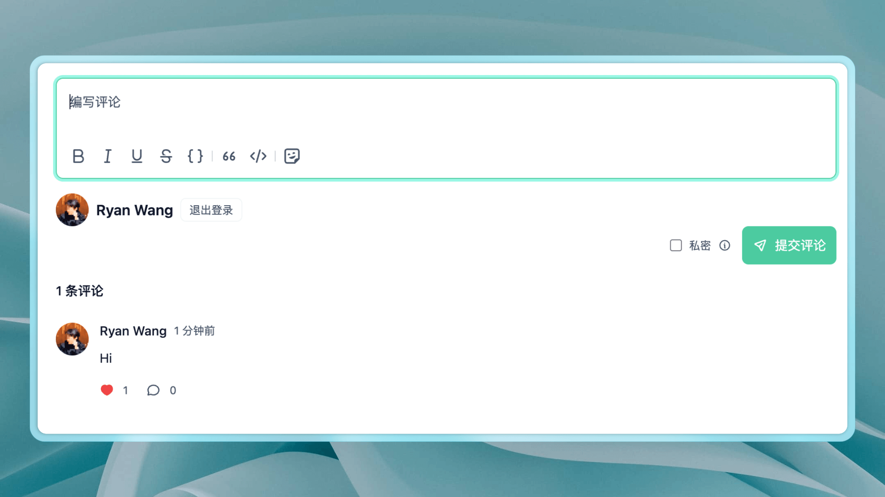

# plugin-comment-widget

适用于 Halo 2.27.0 及以上版本的通用评论组件插件，为前台提供完整的评论解决方案。

## 功能特性

- 支持评论和回复，可分别配置分页条数
- 支持评论和回复固定链接，点击发布时间可复制链接，访问链接直接查看对应讨论
- 支持私密评论，限制评论内容的可见范围
- 支持表情选择，可自定义评论框占位符
- 支持上传 JPEG、PNG、GIF、WebP、AVIF 图片，可配置文件大小限制、存储策略和匿名上传权限
- 支持评论草稿保存
- 支持字母数字验证码、算术验证码、Cloudflare Turnstile 和 ALTCHA 验证
- 可针对所有用户、匿名用户或指定角色启用验证，ALTCHA 支持手动和自动验证模式
- 支持 Gravatar 头像，可自定义头像服务镜像地址和适用用户范围
- 支持显示评论者设备信息
- 支持离线解析并显示评论和回复的 IP 属地，开启后自动补齐历史评论
- 支持通过 CSS 变量自定义样式，适配明亮和暗黑模式

## 使用方式

1. 下载，目前提供以下两个下载方式：
    - GitHub Releases：访问 [Releases](https://github.com/halo-dev/plugin-comment-widget/releases) 下载 Assets 中的 JAR 文件。
    - Halo 应用市场：<https://www.halo.run/store/apps/app-YXyaD>。
2. 安装，插件安装和更新方式可参考：<https://docs.halo.run/user-guide/plugins>。

> 需要注意的是，此插件需要主题进行适配，不会主动在内容页加载评论组件。

## IP 属地

在插件「基本设置」中开启「显示 IP 属地」，评论和回复会显示发表时 IP 对应的省份（中国大陆）或国家/地区。默认关闭，开启后内网、无效或无法定位的 IP 显示「未知」。新评论异步解析，历史评论分批补齐；缺少原始 IP 的记录无法补齐。反向代理需要正确传递客户端 IP，否则只能解析代理的地址。

归属地由随插件打包的 [ip2region](https://github.com/lionsoul2014/ip2region) IPv4/IPv6 数据库离线解析，不发送 IP 给第三方。结果保存后不会随数据库升级自动改写。关闭开关仅隐藏组件中的展示，已保存的地区仍可能通过公开接口读取；原始 IP 不写入属地元数据。

## 主题适配

主题可通过 Halo 的自定义标签接入评论组件，并通过 CSS 变量自定义样式和配色。

详细说明请参考 [主题适配文档](./dev/theme-integration.md)。

## 开发文档

- [作为组件使用](./dev/component-usage.md) — 独立安装及 Vue、React 接入示例
- [开发环境搭建](./dev/development.md) — 本地开发环境启动方式
